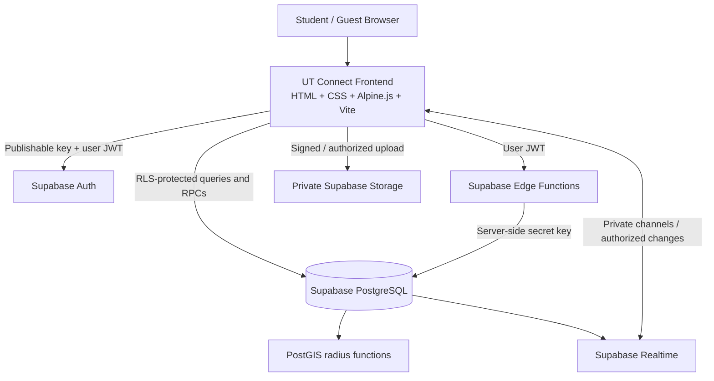

# UT Connect — Architecture Decision Record

## Decision

Use a **modular static frontend + Supabase managed backend** for the first multi-user release. Preserve the approved HTML/CSS/Alpine.js UI; introduce Vite and ES modules as a build layer rather than forcing a React/Next.js rewrite now.

## Why this fits UT Connect

UT Connect has strongly relational features: profiles, courses, connections, direct messages, study groups, membership roles, agendas, materials, forum posts, and announcements. PostgreSQL transactions and constraints fit these relationships. PostGIS gives a server-side spatial query for the 1/3/5 km radius. Supabase also provides Auth, Realtime, Storage, Edge Functions, and Row Level Security.

Supabase documentation explicitly recommends RLS for tables exposed through its Data API; PostGIS is available as a database extension; Realtime supports messages and presence; Edge Functions can keep secrets and privileged operations on the server.

## Logical architecture



## Trust boundaries

### Browser (untrusted)

May contain:
- Supabase project URL.
- Supabase publishable key.
- Current user's short-lived session token.
- UI preferences and non-sensitive cache.

Must never contain:
- Supabase secret key (or legacy service-role key).
- Database password/connection string.
- `NIM_HMAC_SECRET`.
- Raw NIM in logs, analytics, URLs, or persistent local storage.
- Another student's exact coordinates.

### Database (authoritative state)

- Profiles, verification status, connections, messages, groups, memberships, posts, and notifications are authoritative in Postgres.
- Enable RLS on all exposed tables and apply narrow grants as well as policies.
- `profiles` and `user_locations` are not public directory tables.
- `user_locations.location` is exact geography and can be read directly only by the owner.
- Mutating connection and group membership state uses controlled RPCs, rather than unrestricted client updates.

### Edge Functions (trusted server-side boundary)

- Validate the caller using the bearer JWT; do not trust a user ID supplied in request JSON.
- Compute NIM HMAC in memory; never log the raw NIM.
- Apply rate limits to NIM lookup and matching endpoints.
- Call `find_nearby_students` with the authenticated user ID.
- Return only initials, program, rounded distance, and a jittered marker point. Never return the stored geography.

## Critical product flows

### Registration and verification

1. User creates an Auth identity using the selected email/OTP flow.
2. Frontend sends full name, faculty, program, semester, and NIM to a protected registration Edge Function.
3. Function validates input, normalizes NIM, computes HMAC-SHA256 with a server-only secret, and writes the profile as `pending`.
4. The app must show **Pending verification**, not **Verified**, until an authorized official integration or manual review changes the status.
5. A NIM with 9 digits is only format-valid; it does not prove that the person is a UT student.

### Location tagging and nearby map

1. User gives explicit consent and selects a pin (manual selection or browser geolocation permission).
2. The exact point is sent over HTTPS to a protected endpoint and stored in `user_locations`.
3. Other browsers cannot query another person's raw row due to RLS and grants.
4. The browser requests nearby students through the Edge Function. Radius is restricted to 1,000, 3,000, or 5,000 metres.
5. Server query filters on true coordinates using PostGIS; the function returns a distance bucket and jittered map point, not the true point.
6. A NIM search performs HMAC matching only inside the active radius, and is rate-limited. Empty results return the same generic message so the endpoint does not reveal whether an account exists elsewhere.

### Academic matching and personal chat

1. Match candidate generation uses selected course IDs, topics, interests, and study times.
2. A request inserts a `pending` connection via `request_connection`.
3. Recipient approves/rejects via `respond_connection`.
4. `direct_messages` can be read/inserted only by participants while the connection is `accepted`.
5. No automatic bot response is used. Demo messages are created by controlled test accounts only.

### Study groups

- Create a group with capacity 2–100, mode (online/offline), and access mode (open/approval/private).
- The database trigger makes the creator the first admin.
- `join_study_group` locks the group row before checking capacity, reducing concurrent overfill risk.
- Approval requests remain pending until an admin/co-admin responds.
- Private groups require a group invite.
- Group messages, agenda, and material metadata are readable only by active members.
- Storage object policies must be added before enabling file upload in production.

### Forum and Informasi UT

- Forum is available to verified student accounts.
- Guest-readable information must be published and limited to `competition`, `job`, `seminar`, and `tips` categories.
- Student-submitted information defaults to unpublished and verified-student audience. A moderator must publish it; the browser cannot set `is_published` or change the audience.

## Realtime policy

Persist every message in Postgres first. Add Realtime subscriptions only for the relevant `direct_messages` and `group_messages` tables/channels after access policies are tested. Use private channels and explicit Realtime Authorization policies. Do not send message text through public channels.

## Frontend evolution

Keep the current approved UI as the visual baseline. Convert the single-file prototype into a Vite project with modules such as:

```text
src/
  app.js
  lib/supabase.js
  services/auth.service.js
  services/location.service.js
  services/matching.service.js
  services/chat.service.js
  services/groups.service.js
  services/forum.service.js
  components/
  styles/
supabase/
  migrations/
  functions/
```

No visual redesign is required during this refactor unless QA identifies a usability defect. Keep the five main navigation areas and the approved white / UT blue / UT yellow palette.

## Environments

- `local`: local code development and local test data.
- `staging/demo`: synthetic students and prepared demo flows; not real personal information.
- `production`: real users only after verification, privacy review, security tests, backup plan, and release checklist.

Never reuse real student location or NIM data as demo seed content.

## Decisions still requiring team input / external dependency

- UT-approved student verification method or official integration (required before calling accounts verified).
- Data-retention and deletion policy for location and account data.
- Moderation role and process for Informasi UT.
- Domain and deployment provider for the static frontend.
- Storage upload limits and allowed file types for study materials.
- Whether users under 18 may register; age policy and safeguards need to be decided before public launch.
