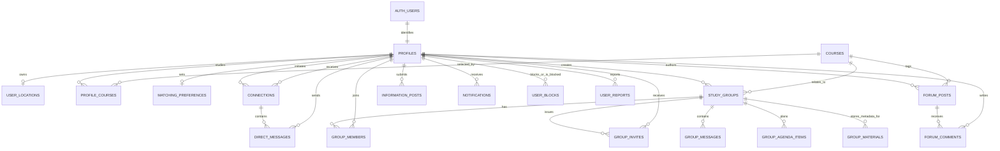

# UT Connect — Entity Relationship Overview

## Main table responsibilities

| Table | Responsibility | Sensitive data? |
|---|---|---|
| `profiles` | Name, faculty, program, semester, verification state | Yes; select is owner-only |
| `user_locations` | Exact user-selected/geolocated point and radar opt-in | Highly sensitive; owner-only direct access |
| `courses` | Master list of UT course options | No |
| `profile_courses` | Courses selected by each student | Personal academic data |
| `matching_preferences` | Topics, interests, learning time | Personal preference data |
| `connections` | Request/accept/reject state between two students | Private relationship data |
| `direct_messages` | 1-on-1 message history | Private communication |
| `study_groups` | Group metadata, mode, capacity and access mode | Depends on group privacy |
| `group_members` | Membership and roles | Private group membership |
| `group_invites` | Invitations to private groups | Private |
| `group_messages` | Group conversations, replies, mentions, pins | Private group communication |
| `group_agenda_items` | Schedules, targets, tasks, polls, notes | Private group content |
| `group_materials` | Metadata and private Storage object path | Private file metadata |
| `forum_posts/comments` | Verified-student peer-help discussion | Student-generated content |
| `information_posts` | Public or verified-student information feed | Must be moderated before publishing |
| `notifications` | Per-user alerts | Private |
| `user_blocks` | Safety controls | Private |
| `user_reports` | Reports for moderation | Private |
| `nim_search_events` | Rate-limit audit events; never store raw NIM | Private server table |

## Deliberate separation

- `auth.users` owns authentication credentials and sessions.
- `profiles` owns student-facing profile metadata and an HMAC digest of NIM, not plaintext NIM.
- `user_locations` is separated from `profiles` because location requires stricter access controls.
- `connections` controls whether direct chat is allowed.
- `group_members` controls access to group chat, agenda, and materials.
- `information_posts` separates guest-visible content from student-only information.
